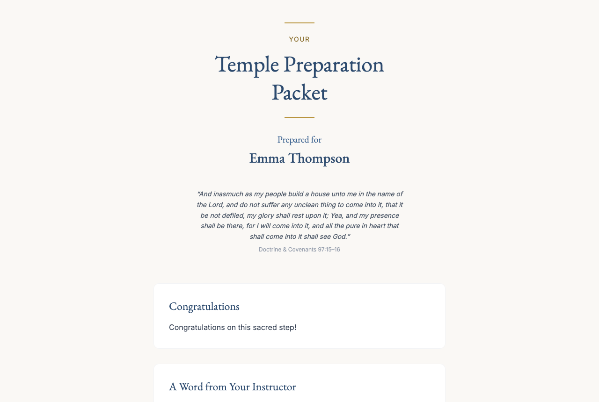
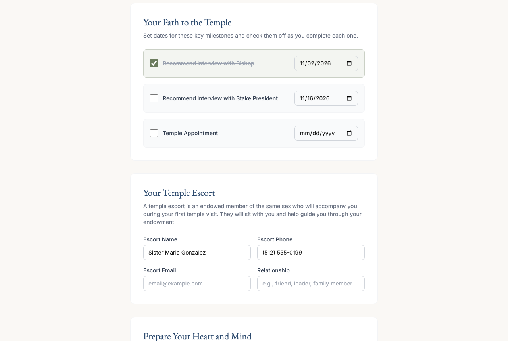
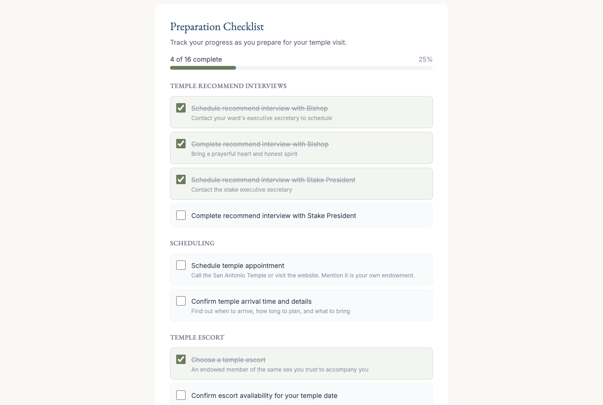
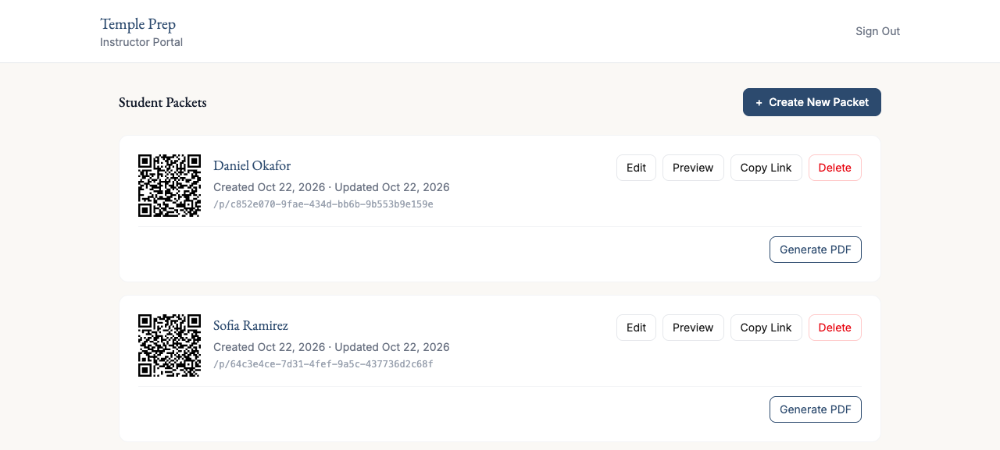

<div align="center">

# Temple Prep

**Personalized, interactive temple preparation packets for members of The Church of Jesus Christ of
Latter-day Saints who are getting ready for their first temple visit.**

[templeprep.lucasacastro.com](https://templeprep.lucasacastro.com)




</div>

## Why

Temple preparation students usually get a generic paper handout, with contacts, talks and a checklist they have
to keep track of on their own.

Temple Prep replaces the handout with a **personal packet**. The instructor fills in the student's ward
contacts and a personal note, and the student gets a mobile-friendly page they can come back to and update all
the way to their temple day.

## Features

<table>
  <tr>
    <td width="50%"></td>
    <td width="50%"></td>
  </tr>
  <tr>
    <td align="center"><sub>Milestones with dates, and the temple escort</sub></td>
    <td align="center"><sub>A preparation checklist grouped by category</sub></td>
  </tr>
</table>

**For students**, each packet is private and saved as they go:
- Milestones (bishop interview, stake interview, temple appointment) with dates and check-offs
- Temple escort details
- Curated General Conference talks and key scriptures
- Reflection questions and a temple-day journal
- A preparation checklist covering interviews, scheduling, clothing, travel and spiritual preparation
- Their important contacts: bishop, executive secretary, ministering brothers and sisters, instructor
- Access by name + PIN from the home page, or by direct link

**For instructors**, in a PIN-protected portal:
- Create and edit packets with each student's details and a personal note
- Share packets by link or QR code
- Generate a printable **PDF** of any packet

<p align="center"></p>

## Architecture

The whole thing runs on Cloudflare: one Worker serves both the React SPA and the API.

| Layer           | Technology                                                              |
| --------------- | ----------------------------------------------------------------------- |
| Frontend        | Vite · React · TypeScript · React Router v7 · Tailwind CSS v4           |
| API             | Cloudflare Workers + [Hono](https://hono.dev)                           |
| Database        | Cloudflare D1 (SQLite) with [Drizzle ORM](https://orm.drizzle.team)     |
| PDF generation  | Cloudflare Workflows + Browser Rendering, with PDFs stored in R2        |
| Dev server      | `@cloudflare/vite-plugin`: frontend and Worker on one port, with HMR    |
| Tests           | Playwright end-to-end                                                   |

```
src/          React SPA: admin portal, student packet, print view
worker/       Hono API: routes, auth middleware, PDF workflow
migrations/   D1 schema migrations
e2e/          Playwright tests
specs/        Feature specs written before implementation
```

The feature specs in [`specs/`](specs/) were written first and then implemented phase by phase. They're a good
place to start reading: [plan](specs/PLAN.md) · [data model](specs/database.md) · [API](specs/api.md) ·
[admin UI](specs/admin-ui.md) · [student packet](specs/student-packet.md) · [tests](specs/e2e-tests.md)

## Run it locally

Requirements: Node.js 22+ and pnpm 10+.

```bash
pnpm install
echo "ADMIN_PIN=1234" > .dev.vars   # local instructor PIN (gitignored)
pnpm db:migrate:local               # create the local D1 database
pnpm dev                            # http://localhost:5173
```

- Instructor portal: `http://localhost:5173/admin`
- Student packet: from the home page (name + PIN), or `http://localhost:5173/p/<id>`

```bash
pnpm --filter e2e exec playwright install   # first time only
pnpm test:e2e
```

## Deploy

```bash
wrangler d1 create temple-prep-db      # then put the database_id in wrangler.jsonc
wrangler secret put ADMIN_PIN
pnpm db:migrate                        # run migrations against the remote D1
pnpm run deploy
```
